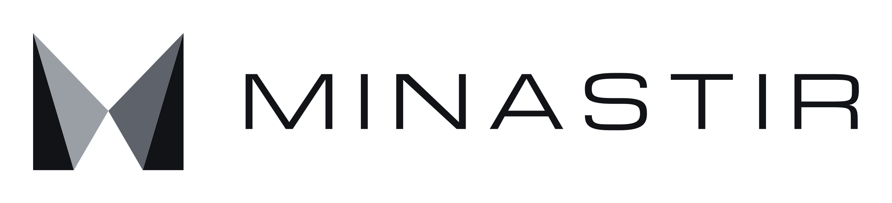
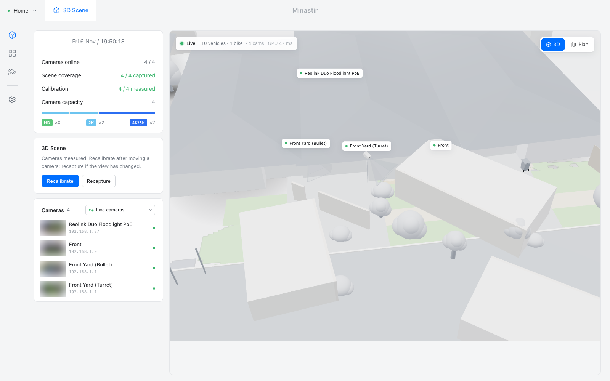

<p align="center">
  
</p>

<p align="center"><b>A live 3D view of your home, built from the security cameras you already have.</b></p>

Minastir connects to ordinary ONVIF / RTSP security cameras. It works out where each camera is and what it sees, then shows the people, cars and pets they see as moving objects in one live 3D scene of your property. There's no cloud, no special hardware and no manual 3D modelling. Everything runs on your own machine.

<p align="center"></p>

> **Status: early and experimental.** It works end to end on a real four-camera home, but it has been tuned on that one site. Expect rough edges, and please report what breaks on yours.

## What it does

- **Finds your cameras.** Uses ONVIF WS-Discovery on the local network, or you paste an RTSP/RTSPS stream URL (UniFi Protect, Reolink, Hikvision, …).
- **Calibrates each camera from its own picture.** A monocular depth model (MoGe-2) and a segmentation model (SegFormer) measure the camera's lens, tilt and mounting height. Barrel distortion is measured from how straight the kerbs become once it's corrected.
- **Places cameras relative to each other.** Points are matched between overlapping views (ALIKED + LightGlue) and the cameras are chained into one site frame. An aerial or site photo can then be fitted underneath, and house outlines traced on it.
- **Tracks what moves, in 3D.** Runs a detector (D-FINE) on every camera, places each detection on the ground, and merges sightings of the same person or car across cameras. The merging uses a small learned association model plus appearance fingerprints (DINOv2/v3), with body keypoints (RTMPose) to tell children from adults.
- **Gets parked cars right.** A car's heading comes from where its wheels are (Grounding DINO), so a car parked along the kerb is drawn along the kerb.
- **Renders in the browser.** A React + three.js app draws the scene, a plan view and live camera previews. It only renders; all processing happens in the Rust backend.

## How it fits together

```
crates/core/       Rust: ONVIF discovery and probing, RTSP capture, camera/site data types (CLI: `minastir`)
crates/vision/     Rust: calibration, registration, detection, tracking, association; ONNX models via `ort`
crates/server/     Rust: axum JSON/WebSocket API; runs the live engine; serves the built web app
apps/web/          TypeScript: React + Vite + three.js UI
apps/site/         Astro: project website
packages/objects/  three.js object library (cars, people, trees, houses) shared by the UI
tools/record/      Python: record camera streams and turn recordings into synchronised replays
tools/model-export/ Python: export third-party models to ONNX
scripts/           Setup helpers
brand/             Logos and brand guidelines
```

Models run through ONNX Runtime. On Apple Silicon they use CoreML (GPU / Neural Engine), and anywhere else they fall back to the CPU.

## Requirements

| | |
|---|---|
| **Rust** | The toolchain is pinned in `rust-toolchain.toml`; `rustup` installs it automatically |
| **Node.js** | 20 or newer |
| **ffmpeg** | `ffmpeg` and `ffprobe` on your `PATH` (`brew install ffmpeg`, `apt install ffmpeg`) |
| **Disk** | About 4 GB for models |
| **Machine** | Developed on an Apple Silicon Mac (M-series). Linux works on CPU but is slower; a GPU build of ONNX Runtime helps. |
| **Cameras** | Any that expose RTSP. ONVIF makes discovery automatic. Cameras whose views overlap can be placed relative to each other automatically. |

## Setup

```sh
git clone <this repo> minastir && cd minastir
npm install                       # web app and workspace tooling
scripts/fetch-models.sh           # ~3.5 GB of models into ./data/models (optional: see below)
npm run dev                       # API on :8080 + UI on http://localhost:5173
```

Open **http://localhost:5173**.

The model download is optional up front: the server fetches the core models itself the first time it needs them. Running the script first just avoids long waits partway through setup. `scripts/fetch-models.sh --core` skips the optional extras (pose, Segment Anything, describer).

### First run: from cameras to a 3D scene

1. **Add cameras.** Open the device list. Cameras found by ONVIF appear automatically; choose **Adopt** and enter their username and password. For UniFi Protect, enable *RTSPS output* on the camera in Protect, then use **Add camera** and paste the `rtsps://…` link.
2. **Place them roughly.** In the plan view, drag each camera to about where it is mounted and turn it to face the right way. A metre or two off is fine.
3. **Calibrate.** Choose **Calibrate cameras**. Minastir measures each camera's lens, tilt and height from a people-free background frame, and then matches overlapping cameras to refine their positions. Use **Recapture** to grab fresh frames if a view has changed. The first run downloads about 1.7 GB of models and takes a few minutes.
4. **Add a site photo (optional).** Upload an aerial or site image under **Map photo**, then use **Auto-align** or align it by hand. **Trace house** outlines buildings (click a roof).
5. **Watch.** The live engine starts on its own. People, cars and pets appear in the 3D scene and the plan view. Hover over a camera in the left sidebar to see its live picture.

### Production build

```sh
npm run build   # static UI into apps/web/dist + release server
npm start       # UI and API together on http://127.0.0.1:8080
```

## Configuration

Everything about your site (cameras, credentials, calibrations, site photo, recordings) lives in the data directory. It is git-ignored and never leaves your machine.

| Variable | Default | Purpose |
|---|---|---|
| `MINASTIR_ADDR` | `127.0.0.1:8080` | Bind address. **There is no authentication yet: keep it on localhost or a trusted network.** |
| `MINASTIR_DATA` | `./data` | Data directory. Camera credentials are kept in `credentials.json` (file mode 0600). |
| `MINASTIR_WEB_DIR` | `./apps/web/dist` | Built UI to serve |
| `MINASTIR_REPLAY` | none | Play a recorded replay (a folder of `<camera id>.mp4`) instead of the live cameras. It can also be switched in the UI. |
| `MINASTIR_LIVE` | `1` | `0` turns the live engine off |
| `MINASTIR_LIVE_FPS` | `8` | Frames per second analysed per camera |
| `MINASTIR_GPU` | `1` | `0` forces CPU inference |
| `MINASTIR_DETECTOR` | `x` | `m` uses the smaller, faster D-FINE-M detector |
| `MINASTIR_POSE` | `measure` | `off`, `measure` (heights only), `place`, or `ankles` |
| `MINASTIR_ASSOC` | learned | `off` uses the hand-set association rule instead of the learned model |
| `MINASTIR_WHEELS` | on | `off` stops reading car headings from wheels |
| `MINASTIR_HARVEST` | none | Write association training data to this `.jsonl` file |

## Test videos instead of live cameras

Recording a few minutes from every camera and replaying it makes changes repeatable:

```sh
python3 tools/record/record.py --data data --out data/recordings --now --hours 0.25
python3 tools/record/recording_replay.py data/recordings/<start> --name my-clip
MINASTIR_REPLAY=my-clip npm run dev
```

## Command line

The core crate also works without the UI:

```sh
cargo run -p minastir-core -- discover
cargo run -p minastir-core -- scan --host 192.168.1.20 -u admin -p '…'
cargo run -p minastir-core -- capture -u admin -p '…'
```

`crates/vision/examples/` holds the diagnostic tools used during development: calibration checks, lens and kerb fitting, site-photo alignment, detector comparisons, and association training (`assoc_train`). Each file's header comment says what it does and how to run it:

```sh
cargo run --release -p minastir-vision --example <name> -- <args>
```

## Development

```sh
cargo test --workspace     # Rust tests
npm run typecheck          # TypeScript
npm run dev:site           # project website on :4321
```

The guiding principles:

- **The backend does the work; the browser only draws.**
- **Learn or measure instead of hand-tuning.** Lens distortion, camera height and placement are measured from the scene itself, and association is learned from data. A hand-set rule stays available as a switch when a learned part replaces it.
- **Nothing site-specific in code.** Anything about a particular home belongs in the data directory.

Contributions are welcome. Please open an issue first to discuss anything larger than a fix.

## Privacy and security

- All video processing is local. Minastir makes no network calls except to your cameras and to download models.
- The server has **no login**. Don't expose port 8080 to the internet.
- Your `data/` folder holds camera passwords, stream URLs and images of your property. Don't commit or share it.

## License

The code is licensed under the [Apache License 2.0](LICENSE).

The Minastir name and logos in `brand/` identify this project and are not licensed for use as the branding of other products.

**Models are not part of this repository.** They are downloaded from their publishers and come under their own licenses, some of which are not Apache-2.0. Check each model's card before commercial use; in particular, SegFormer (NVIDIA) and DINOv3 (Meta) have their own terms.

| Model | Used for | Source |
|---|---|---|
| MoGe-2 ViT-L | Depth and geometry for calibration | [Ruicheng/moge-2-vitl-normal-onnx](https://huggingface.co/Ruicheng/moge-2-vitl-normal-onnx) |
| SegFormer-B5 (ADE20K) | Road, footpath, wall… labels | [Xenova/segformer-b5-finetuned-ade-640-640](https://huggingface.co/Xenova/segformer-b5-finetuned-ade-640-640) |
| D-FINE X / M | Object detection | [onnx-community/dfine_x_obj2coco-ONNX](https://huggingface.co/onnx-community/dfine_x_obj2coco-ONNX) |
| ALIKED + LightGlue | Matching points between cameras | [fabio-sim/LightGlue-ONNX](https://github.com/fabio-sim/LightGlue-ONNX) |
| DINOv2 small, DINOv3 ViT-B | Appearance fingerprints | [onnx-community](https://huggingface.co/onnx-community) |
| Grounding DINO tiny | Finding wheels for car headings | [onnx-community/grounding-dino-tiny-ONNX](https://huggingface.co/onnx-community/grounding-dino-tiny-ONNX) |
| RTMPose-m | Body keypoints (optional) | [OpenMMLab](https://github.com/open-mmlab/mmpose/tree/main/projects/rtmpose) |
| Segment Anything ViT-B | Roof tracing (optional) | [vietanhdev/segment-anything-onnx-models](https://huggingface.co/vietanhdev/segment-anything-onnx-models) |
| Qwen3-VL 2B | Naming tracked objects (optional) | [onnx-community/Qwen3-VL-2B-Instruct-ONNX](https://huggingface.co/onnx-community/Qwen3-VL-2B-Instruct-ONNX) |
